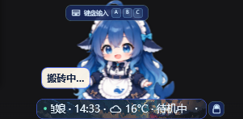

# 蓝色鲸鱼娘桌宠 · DSH Web 插件 + Windows 桌面版



一套角色形象、两套运行方式：

- **DSH Web 插件**：右下角显示当前会话的上下文、token、skills、agent 状态。
- **独立 Windows 桌面版**：透明置顶、可拖动，带本地时间问候、天气、休眠和互动状态。

角色图来自 `img/`，已去掉棋盘格背景并生成透明资源。主形象、休眠形象和互动形象都可以在设置中增删改，每种状态至少保留 1 张。

## 1. DSH Web 插件

### 功能

- 角色图显示在右下角，状态栏在角色下方，**单行**显示：
  `DSH · 上下文 64% · TOKEN 149M · 技能 53 · AGENT CORDIS`
- 点击单行状态栏展开会话明细：上下文构成、token 输入/输出/缓存、skills 列表、agent 状态。
- 点击角色随机说一句话，并随机切换到互动形象；默认 30 秒后回到主形象。短句可在设置中逐行编辑。
- 超过默认 5 分钟没有键盘/鼠标输入时切换到休眠形象；有输入后回到主形象。
- 键盘输入时显示 `⌨ 键盘输入` + A/B/C 键帽徽标；鼠标移动显示 `🖱 鼠标移动`，点击显示 `🖱 点击`。
- 图片切换使用淡入淡出过渡。
- 左上角 📝 打开纸质备忘录：横线纸、勾选框、已完成删除线；勾选内容会出现在点击互动中，长内容自动截断并保留完整悬停提示。
- 右上角齿轮打开设置。状态栏隐藏后这两个按钮仍然可见；设置校验提示改为顶部消息气泡，保存成功会在角色处提示。
- 界面大小和**角色大小分别可调**（各 0.1–1.5 倍），可以只放大角色而不改变状态栏，也可以整体缩放。
- 状态栏、设置、备忘录的文字大小分别可调；界面主题色、三处文字颜色也可以分别设置。
- Web 设置弹窗有独立大小，不受界面大小影响；设置弹窗可滚动，保存按钮固定在底部可见，双列输入框不会重叠。
- 设置按钮、备忘录按钮、互动气泡、键鼠状态也能分别设置大小；它们在桌面版不再跟随角色缩放。
- 天气文字大小独立于状态栏文字大小。
- 超过设定时间没有点击角色时，角色会主动聊天；间隔和主动聊天内容可在设置中编辑。

### 设置项

点击角色右上角齿轮，或展开状态栏后点“设置”：

- 是否显示状态栏
- 启动时是否按本地时间打招呼
- 是否在角色上方显示天气（如果当前浏览器允许外部请求）
- 开机自启动
- 显示设备信息 / 显示移动设备（含 USB 移动硬盘）/ 贴边自动收起
- 状态栏大小、备忘录界面大小、贴边距离、悬停保持秒数、喝水提醒间隔
- 工作日（周一–周日）、上班时间、下班时间
- 上班“搬砖提示框”开关、文字、大小、文字大小
- 下班前提示开关、提前提醒分钟数、下班提示开关，以及两段提示文字
- 天气城市（只能填一个城市，留空按 IP 自动定位）
- 界面大小（0.1–1.5）
- 角色大小（0.1–1.5）
- 状态栏 / 设置 / 备忘录 / 互动气泡文字大小（8–32 px）
- 界面主题色、状态栏文字颜色、设置文字颜色、备忘录文字颜色
- Web 设置弹窗大小；设置按钮 / 备忘录按钮 / 互动气泡 / 键鼠状态大小
- 天气文字大小（独立于状态栏）
- 空闲判定时长（分钟）
- 主动聊天间隔（分钟，0=关闭）
- 互动形象持续时长（秒）
- 切换动画时长（毫秒）
- 主形象 / 空闲形象 / 互动形象图片路径（每行一个）
- 点击互动短句（每行一条，至少 1 条）
- 主动聊天内容（每行一条）
- 恢复默认

Web 版图片路径支持插件 assets 路径或 HTTPS URL。浏览器不能直接读取 `D:\...` 本地绝对路径；本地图片请使用桌面版。

Web 设置保存在 `localStorage` 的 `dsh-blue-whale-pet.settings.v2`；Web 备忘录保存在 `dsh-blue-whale-pet.memos.v1`。

### 已安装

```text
@local/dsh-blue-whale-pet@2.1.0
```

安装到当前 `desktop` profile。若刷新后没出现，到「插件」页关闭再打开「蓝色鲸鱼娘桌宠」。

## 2. Windows 桌面版

### 运行

直接运行：

```text
dist\WhalePet.exe
```

这是真正的单文件 self-contained exe，不需要安装 .NET 运行时，也不需要旁边的 `Assets` 文件夹。首次启动会把内嵌的默认角色图解压到 `%LOCALAPPDATA%\DSHWhalePet\assets`。


### 功能

- 透明、无边框、始终置顶，可拖动；位置自动保存。

- 设置中可开启/关闭开机自启动（写入当前用户 `HKCU\Software\Microsoft\Windows\CurrentVersion\Run`）。

- 单实例运行：重复启动只会激活已运行的鲸鱼娘，不会出现多个桌宠。

- 展开状态栏可显示设备信息：内存、CPU、显卡、系统盘使用情况，以及**网络状态和实时上传/下载速度**（取不到的传感器会自动省略）。

- 支持工作日、上下班时间、上班“搬砖中”侧边提示，以及可自定义提前分钟数的下班前提醒/下班时提醒。

- 支持拖到屏幕边缘自动收起为贴边小标签，鼠标移入展开、移出收起，可在设置中关闭。

- 只有点击角色形象才会触发互动；键盘输入、移动鼠标、点击其他区域都不算互动。

- 启动时根据电脑本地时间打招呼。

- 联网时在角色上方显示当地天气：温度、天气现象、降雨/降雪、风力等级；**天气位置只能填写一个城市**（留空按 IP 自动定位，填写多个城市会被拒绝）。

- 超过 5 分钟没有系统级键盘/鼠标输入时进入休眠形象；有输入后恢复主形象。

- 系统级键盘/鼠标监听：键盘输入显示 `⌨ 键盘输入` + 键帽，鼠标移动显示 `🖱 鼠标移动`，点击显示 `🖱 点击`，并带指针位置/压扁动效。

- 点击角色随机说一句话并切换互动形象，默认 30 秒后回到主形象/休眠状态；短句可配置。

- 单行状态栏在角色下方，点击展开桌面状态、空闲倒计时、天气详情、配置路径；状态栏变窄时内容会自动左右滚动，鼠标悬停到文字上暂停，移开后继续滚动。

- 天气栏显示在角色上方居中；角色上方另有互动气泡时，天气栏位于气泡上方居中。

- 备忘录通过状态栏“功能”栏或右键菜单打开：横线纸、点击内容标记完成（文字下方红线）、已完成删除线；横线与文字行高对齐，被标记的内容会出现在点击互动中，长内容自动截断并保留完整 ToolTip。

- 界面大小和**角色大小分别可调**（各 0.1–1.5 倍）。

- 状态栏、设置、备忘录、互动气泡的文字大小分别可调，默认 10 / 11 / 12 / 12 px；主题色和三处文字颜色可分别设置，并为所有颜色项提供色板/十六进制颜色选择器。

- 设置按钮、互动气泡、键鼠状态的大小分别可调（0.5–2 倍）；角色左上角的备忘录快捷图标已移除。

- 状态栏贴合在角色下方，并可单独调整状态栏大小；状态栏详细界面的宽度会跟随状态栏宽度变化。

- 天气文字大小与状态栏文字大小相互独立；天气城市始终可编辑，天气显示开关只控制角色上方天气框。

- 设置按钮默认隐藏，可在设置中开启。

- 状态栏详细界面顶部固定显示“功能”栏（备忘录、设置、天气、闹钟、剪贴板、截图、锁屏），不随内容滚动；下方“桌面状态”和“形象状态”自动换行，不再被截断。

- 状态栏很窄时，锁屏和移动设备图标会自动贴在状态栏右侧显示，使用与图标按钮一致的深色圆角背景；状态栏足够宽时图标位于状态栏内部。

- 互动气泡固定显示在角色上方居中；状态栏很窄时也不会偏离桌宠边界。

- 右键菜单、删除/清空确认框使用与桌宠主题色一致的深色圆角样式；状态栏、设置、闹钟、备忘录、剪贴板等所有滚动条改为透明毛玻璃样式。

- 界面主题色会同时应用到状态栏、详细面板、天气条、按钮、右键菜单、设置窗口，以及剪贴板、闹钟、闹钟时间选择、截图编辑、颜色选择等新增界面，不再只改变边框颜色。

- 主题背景：可在设置中开启背景图片、选择图片文件并调整透明度（0–1）。图片显示在设置界面、状态栏、状态栏详细界面、剪贴板界面、闹钟界面等面板背面；**角色形象区域保持透明，不显示背景图片或背景颜色**。

- 截图：可在设置中开启全局截图快捷键（Ctrl/Alt/Shift/Win + A–Z、0–9、F1–F12，默认 Ctrl+Alt+A）。截图和标注在同一个全屏界面完成：以鼠标按下位置为选区起点，拖动选区后可继续拖动边缘调整区域，再直接使用方框、圆、直线、箭头（小/中/大）、文字（可调字号）、颜色、线宽、撤销、清空等工具标注；工具栏默认显示在选区下方 20px，下方空间不足时自动显示在选区上方 20px。点“复制”或按 Enter 自动复制到剪贴板，点“保存”可另存为 PNG。重复按快捷键会激活当前截图界面，不会叠加多个截图窗口。右键菜单“截图...”和状态栏“截图”按钮也可直接启动。

- 贴边收起距离 0–50px 可调；悬停展开后的保持时间可调（默认 3 秒）。

- 搬砖提示框独立显示在角色左侧，支持大小和文字大小设置；下班前提示和下班提示分别开关，其中下班前提醒可设置提前 1–120 分钟。

- 备忘录支持按**内容关键字**搜索，并在搜索框右侧提供时间筛选（全部时间 / 今天 / 近 3 天 / 近 7 天 / 近 30 天 / 本月）；搜索只匹配内容，不再匹配日期。

- 备忘录**点击内容**即在互动中显示（文字下方出现红色细线），再次点击取消；不再使用勾选框。

- 备忘录支持**编辑**（✎ 按钮，修改后原始添加时间不变）和**批量删除**（批量模式下勾选，支持全选）；单条删除和批量删除都会先弹出确认对话框。

- 久坐提醒：可在设置“提醒与工具”中开启，间隔 0–240 分钟，0 表示关闭；连续使用电脑到时间后通过角色气泡提醒起来活动，并可选择同时弹出置顶提示窗。

- 闹钟提醒：可在设置中开启，支持多个闹钟（最多 10 个）。可设置“每天”或指定年月日，开始时间支持直接输入（9、930、9:30 等会自动校正为 HH:mm），也可点“选择日期时间…”按年、月、日、时、分选择；结束时间可留空（只提醒一次），或设置时间段（进入时间段后提醒一次）。每个闹钟可单独选择是否弹窗提醒（默认弹窗），触发时同时显示互动气泡和置顶弹窗。闹钟列表的每条设置使用与剪贴板记录一致的主题色卡片背景。启用后展开状态栏会出现“闹钟”快捷按钮，右键菜单也有“闹钟提醒...”。

- 设置启用闹钟后，右键菜单和状态栏详细界面都会出现闹钟快捷入口，可直接编辑闹钟并保存。

- 剪贴板历史：可在设置中开启，只记录文本，最多 50 条，保存在本机；使用 Windows 剪贴板监听实时记录，打开剪贴板窗口后复制的新内容会立即出现在列表中，无需关闭重开。展开状态栏点“剪贴板”或右键菜单“剪贴板历史”打开，支持复制、单条删除和清空。

- 一键锁屏：可在设置中关闭；展开状态栏点“锁屏”或右键菜单“锁屏”立即锁定 Windows。

- 状态栏可显示所有固定硬盘和移动设备图标；移动设备支持打开文件夹，右键菜单可真正安全弹出 USB 移动硬盘（刷新缓存、锁定并卸载卷、关闭卷句柄后再通知 PnP 移除设备），失败时会说明占用原因。

- 配置路径支持左键复制、右键打开所在文件夹。

- 设置和备忘录同时保存到 `%LOCALAPPDATA%`、`%APPDATA%` 和用户目录 `.whalepet` 三份，并保留滚动备份；替换 exe 或某一份损坏时会自动读取最新的有效副本。

- 搬砖提示框位于状态栏上方约 12px，并保持在状态栏横向范围内。

- 互动气泡和搬砖提示支持多行与滚轮浏览；喝水提醒默认 30 分钟，可在设置“提醒与工具”中关闭/改间隔，并可选择同时弹出置顶提示窗。

- 重启后状态栏文字大小会按配置恢复，无需再次点击保存。

- 超过设定时间没有点击角色时，角色会主动聊天；间隔和主动聊天内容可在设置中编辑。

- 设置窗口支持修改所有选项、天气城市、两种显示大小、三种文字大小、主题色/文字颜色（带颜色选择器）、三个控件大小、主题背景图片与透明度、截图快捷键、互动短句、主动聊天内容和图片路径；每种状态少于 1 张时拒绝保存。

- 设置校验提示显示在设置窗口顶部消息气泡中；保存成功会在角色处弹出“设置已保存”气泡。

- 图片切换使用 WPF 淡入淡出动画。

- 启动时先显示作者信息动画（文字为 “Create by QiMingcc”），动画结束后再显示桌宠主界面；作者卡片使用当前主题色。

### 配置位置

```text
%LOCALAPPDATA%\DSHWhalePet\settings.json
%APPDATA%\DSHWhalePet\settings.json
%USERPROFILE%\.whalepet\settings.json
%LOCALAPPDATA%\DSHWhalePet\backup\settings-*.json
```

首次启动会把内嵌图片解压到：

```text
%LOCALAPPDATA%\DSHWhalePet\assets
```

备忘录保存到同样的三个目录，文件名是 `memos.json`，并在 `%LOCALAPPDATA%\DSHWhalePet\backup` 保留滚动备份。剪贴板历史保存为同目录下的 `clipboard.json`，只记录文本，最多 50 条。

保存时使用临时文件 + 原子替换，避免异常退出把 JSON 写坏；启动时按修改时间读取最新的有效副本，主文件损坏时会自动从备份恢复。替换或更新 exe 不会影响这些目录。

默认配置使用这些图片；也可以填任意本地绝对路径。删掉 `assets` 文件夹后重新启动，会从 exe 内嵌资源重新解压。

## 3. 重新构建

Web 插件是普通静态 bundle，无需构建。

桌面版：

```powershell
dotnet publish desktop\WhalePet\WhalePet.csproj -c Release -r win-x64 --self-contained true `
  -p:PublishSingleFile=true -p:IncludeNativeLibrariesForSelfExtract=true `
  -p:EnableCompressionInSingleFile=true -o dist\WhalePet-win-x64
```

发布产物是单个 `WhalePet.exe`；`dist\WhalePet.zip` 是它的压缩包。

## 4. 图片与资源

- `assets/main.webp` / `assets/main.png`：主形象
- `assets/sleep.webp` / `assets/sleep.png`：休眠形象
- `assets/play1..4.webp` / `.png`：互动形象
- `icon.png`：插件图标
- `desktop/WhalePet/Assets/`：桌面版内嵌默认图片
- `tools/make_assets.py`：棋盘格背景去除 + 透明资源生成脚本

原始图片仍保留在 `img/`。

## 5. 文件结构

```text
package.json                 Web bundle manifest
cordis.patch.yml             DSH loader row
index.js                     Host 半边（空）
client.js                    Web 桌宠 UI / 状态机 / 设置
assets/                      Web 透明图片资源
locale/                      插件管理器标题与描述
icon.png                     插件图标
desktop/WhalePet/            WPF 桌面版源码（图片以 Resource 内嵌）
dist/WhalePet.exe            已发布的单文件桌面版
dist/WhalePet.zip            单文件桌面版压缩包
docs/                        设计与实施计划
verification/                实机截图
```

## 6. 说明

- Web 版只能感知浏览器内的键盘/鼠标输入；桌面版使用 Windows 系统级低层键盘/鼠标钩子，因此状态更完整。
- 桌面版状态栏显示本机时间、天气、空闲状态；DSH 的上下文/token/skills/agent 数据只在 Web 插件里可用。
- Web 版天气请求受 DSH 浏览器 CSP 限制；被拦截时天气条自动隐藏，不影响桌宠。
- 天气数据来自 Open-Meteo，定位来自 ipwho.is / ipapi.co，均无需 API Key。
- 角色图与图标为项目提供的素材，已做透明化处理；请确认你有权分发这些图片。

## 7. 许可证
- 个人自用项目，仅供学习和娱乐。
