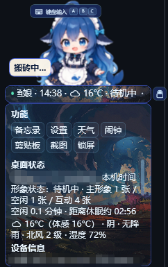

# 蓝色鲸鱼娘桌宠 · DSH Web 插件 + Windows 桌面版


一套角色形象、两套运行方式：

- **DSH Web 插件**：右下角显示当前会话的上下文、token、skills、agent 状态。
- **独立 Windows 桌面版**：透明置顶、可拖动，带本地时间问候、天气、休眠和互动状态。

角色图来自 `img/`，已去掉棋盘格背景并生成透明资源。主形象、休眠形象和互动形象都可以在设置中增删改，每种状态至少保留 1 张。

## 1. DSH Web 插件

### 功能

- 角色图显示在右下角，状态栏在角色下方，**单行**显示：
  `DSH · 上下文 64% · TOKEN 149M · 技能 53 · AGENT CORDIS`
- 点击单行状态栏展开会话明细：上下文构成、token 输入/输出/缓存、skills 列表、agent 状态。
- 点击角色随机说一句话，并随机切换到互动形象；默认 30 秒后回到主形象。短句可在设置中逐行编辑。
- 超过默认 5 分钟没有键盘/鼠标输入时切换到休眠形象；有输入后回到主形象。
- 键盘输入时显示 `⌨ 键盘输入` + A/B/C 键帽徽标；鼠标移动显示 `🖱 鼠标移动`，点击显示 `🖱 点击`。
- 图片切换使用淡入淡出过渡。
- 左上角 📝 打开纸质备忘录：横线纸、勾选框、已完成删除线；勾选内容会出现在点击互动中，长内容自动截断并保留完整悬停提示。
- 右上角齿轮打开设置。状态栏隐藏后这两个按钮仍然可见；设置校验提示改为顶部消息气泡，保存成功会在角色处提示。
- 界面大小和**角色大小分别可调**（各 0.1–1.5 倍），可以只放大角色而不改变状态栏，也可以整体缩放。
- 状态栏、设置、备忘录的文字大小分别可调；界面主题色、三处文字颜色也可以分别设置。
- Web 设置弹窗有独立大小，不受界面大小影响；设置弹窗可滚动，保存按钮固定在底部可见，双列输入框不会重叠。
- 设置按钮、备忘录按钮、互动气泡、键鼠状态也能分别设置大小；它们在桌面版不再跟随角色缩放。
- 天气文字大小独立于状态栏文字大小。
- 超过设定时间没有点击角色时，角色会主动聊天；间隔和主动聊天内容可在设置中编辑。

### 设置项

点击角色右上角齿轮，或展开状态栏后点“设置”：

- 是否显示状态栏
- 启动时是否按本地时间打招呼
- 是否在角色上方显示天气（如果当前浏览器允许外部请求）
- 开机自启动
- 显示设备信息 / 显示移动设备（含 USB 移动硬盘）/ 贴边自动收起
- 状态栏大小、备忘录界面大小、贴边距离、悬停保持秒数、喝水提醒间隔
- 工作日（周一–周日）、上班时间、下班时间
- 上班“搬砖提示框”开关、文字、大小、文字大小
- 下班前提示开关、提前提醒分钟数、下班提示开关，以及两段提示文字
- 天气城市（只能填一个城市，留空按 IP 自动定位）
- 界面大小（0.1–1.5）
- 角色大小（0.1–1.5）
- 状态栏 / 设置 / 备忘录 / 互动气泡文字大小（8–32 px）
- 界面主题色、状态栏文字颜色、设置文字颜色、备忘录文字颜色
- Web 设置弹窗大小；设置按钮 / 备忘录按钮 / 互动气泡 / 键鼠状态大小
- 天气文字大小（独立于状态栏）
- 空闲判定时长（分钟）
- 主动聊天间隔（分钟，0=关闭）
- 互动形象持续时长（秒）
- 切换动画时长（毫秒）
- 主形象 / 空闲形象 / 互动形象图片路径（每行一个）
- 点击互动短句（每行一条，至少 1 条）
- 主动聊天内容（每行一条）
- 恢复默认

Web 版图片路径支持插件 assets 路径或 HTTPS URL。浏览器不能直接读取 `D:\...` 本地绝对路径；本地图片请使用桌面版。

Web 设置保存在 `localStorage` 的 `dsh-blue-whale-pet.settings.v2`；Web 备忘录保存在 `dsh-blue-whale-pet.memos.v1`。

### 已安装

```text
@local/dsh-blue-whale-pet@2.1.0
```

安装到当前 `desktop` profile。若刷新后没出现，到「插件」页关闭再打开「蓝色鲸鱼娘桌宠」。

## 2. Windows 桌面版

### 运行

直接运行：

```text
dist\WhalePet.exe
```

这是真正的单文件 self-contained exe，不需要安装 .NET 运行时，也不需要旁边的 `Assets` 文件夹。首次启动会把内嵌的默认角色图解压到 `%LOCALAPPDATA%\DSHWhalePet\assets`。



### 功能

- 透明、无边框、始终置顶，可拖动；位置自动保存。

- 设置中可开启/关闭开机自启动（写入当前用户 `HKCU\Software\Microsoft\Windows\CurrentVersion\Run`）。

- 单实例运行：重复启动只会激活已运行的鲸鱼娘，不会出现多个桌宠。

- 展开状态栏可显示设备信息：内存、CPU、显卡、系统盘使用情况，以及**网络状态和实时上传/下载速度**（取不到的传感器会自动省略）。

- 支持工作日、上下班时间、上班“搬砖中”侧边提示，以及可自定义提前分钟数的下班前提醒/下班时提醒。主形象、空闲/休眠形象、互动形象中的每个图片链接前都有独立勾选框，可直接启用或停用，新增图片默认启用；每种形象至少保留一张启用图片。

- **角色面板（V1.1.0 增量）**：右键菜单“角色面板...”打开养成面板，右侧固定 5 个 Tab：任务、签到、抽签、背包、成就墙。入口默认显示，可在设置“基础”中关闭。设置中还新增“角色面板设置”，可配置显示/隐藏快捷键（默认 Ctrl+Alt+P）、0–100 连续透明度和 0.5–2 倍界面大小；透明度为 0 时面板不可见且不可点击，但仍可从主形象右键菜单打开设置调高。面板支持按住标题栏或空白区域拖动，位置持久化并限制在屏幕可视区域内；缩小时内容按宽度重排（窄宽度下左栏与 Tab 上下排列），文字不缩小，只出现垂直滚动条。
  - 左栏显示当前形象、等级、好感/心情/饱食进度、经验、连续签到、累计陪伴；主形象支持内置静态图、自定义图片、已解锁 GIF 动态图。
  - 背包分为“食物 / 食材”两个 Tab：初始 10 格，每升 1 级 +1 格；每格 32×32 px、图标 25×25 px，一个物品占一格。点击食物投喂（寿司 +40、鱼肉 +20 饱食度），点击食材提示先烹饪。背包满后物品进入最多 20 格的暂存区，每日 0 点清空，有空位时自动移入。
  - 背包下方是动态图墙：已解锁 GIF 以 100×120 px 等比缩放留白展示，下方显示文件显示名（`067_boss.gif` → `boss`，`Fishing.gif` → `Fishing`）和“N 级解锁”/成就名及启用勾选框；左键图片或勾选框同步启用/取消，最多 5 个；右键打开原始比例预览，滚轮以鼠标为中心缩放 50%–400%，Esc/空白/关闭按钮退出。
  - 每日任务 1 个槽位、0 点刷新；任务接取后才计数，完成自动发奖：好感 +1，并按 50% 概率随机给寿司或鱼肉；上签翻倍，下签不加好感但仍随机给食物。
  - 周签到 7 格、连续签到、3/7 天里程碑；签到奖励固定寿司 ×1，抽签每日 1 次（上签 10% / 中签 80% / 下签 10%），并显示每日随机且当日固定的装饰签语（`txt/LotMessage.txt`）。
  - 钓鱼、烹饪改为从主形象右键菜单进入，菜单显示每日剩余次数，0 次置灰；进入后角色上方显示难度按钮和退出按钮。钓鱼每日 5 次（10–20 秒咬钩、圆环进度、成功区与 60 秒限时），空格每次 +2%，超过 1 秒未按空格后每 0.5 秒自动 −2%（最低 0%，即圆环 12 点位置）；圆环内不再显示任何百分比或文字。烹饪每日 3 次（10 秒进度条、3 个随机烹饪点、先扣 1 条小鱼）。游戏开始后使用窗口级 `KeyDown` 监听空格并设置 `e.Handled`，确保立即积累进度；圆环/进度条直接叠加在桌宠上方，不带半透明遮罩或底色块。
  - 设置“摸鱼游戏设置”可分别调整钓鱼/烹饪进度界面大小（0.5–2）和共用透明度（0–100），调整立即应用，保存后持久化。
  - 53 个成就分五类，隐藏成就完成后才显示；每个成就与等级 2–52 各解锁 1 个 GIF，共 104 个；解锁 GIF 文件位于 `gifs/unlocked/`，仍以加密包形式嵌入，不输出明文。
  - 养成数据保存在本地 SQLite：`%LOCALAPPDATA%\DSHWhalePet\petgame.db`，自动保留 `petgame.db.bak`；导出/导入迁移包、迁移激活、卸载并清除数据已统一移到设置中的“迁移数据”和“卸载桌宠”栏。

- **阅读区域（本轮增量）**：独立置顶、无边框窗口，`Topmost=true`，显示/激活、失活后 100ms 及拖动后调用 `SetWindowPos(HWND_TOPMOST)`；取消标题栏，鼠标可在阅读区域任意位置拖动，文本不参与鼠标命中以避免选中效果；拖边缘缩放（最小 30×30）。位置/宽高持久化，移动限制在虚拟屏幕范围内，边缘吸附，分辨率或多显示器变化时回到主屏；窗口允许与任务栏重叠并在点击任务栏后重新置顶。窗口内不显示翻页按钮、页码或滚动条，按页显示文本，可用上一页/下一页快捷键翻页（默认 `Ctrl+,` / `Ctrl+.`）。读取 txt 后先移除控制字符/换行/制表符、连续空白合并为一个空格，再按字符数分页；设置中提供每页文字数量（1–1500，默认 20）、当前页数（自动限制到总页数并提示）、重置位置按钮；修改每页字数后按原阅读偏移重新计算页码。显示/隐藏、上一页、下一页均使用录制控件，支持 Esc 取消、Backspace 清除为“未设置”，快捷键冲突时提示并清空冲突项，取消/关闭恢复原快捷键。

- **桌面图标收纳区（V1.1.0 增量）**：独立置顶窗口，可拖动标题栏移动、缩放（最小 300×300）、关闭/重新打开，位置和大小持久化；移动限制在虚拟屏幕内，靠近屏幕边缘自动吸附，分辨率或多显示器变化时自动回到主屏可见区域。顶部“+ 分类”新增分类，首个系统默认分类（重命名后仍保持默认身份）不可删除、只能重命名；其他分类可删除，二次确认后图标自动归入系统默认分类；名称为空、超过 20 字或重名会阻止保存并提示。支持从桌面拖入快捷方式、拖出移除、拖到其他分类标签移动；添加按钮多选文件批量加入当前分类；图标可勾选批量删除/移动，双击启动，显示软件图标和名称。分类右键菜单、提示框和下拉框均使用桌宠主题样式，不调用系统 MessageBox。设置中可启用、调整大小、背景颜色和透明度，内容大小不随窗口缩放，内容多时垂直滚动。

- **桌面待办区（V1.1.0 增量）**：独立置顶窗口，可拖动标题栏移动、缩放（最小 300×300）、关闭/重新打开，位置和大小持久化；移动/吸附/多显示器规则与收纳区一致。按紧急（红）/加急（黄）/正常（绿）/不急（蓝）设置待办，状态支持进行中/已完成/未开始，可新增、编辑、删除、完成/恢复，备注参与搜索。筛选区改为平铺多选：时间（全部/今天/昨天/本周/上周/本月/上月/自定义）与紧急程度各自可多选，选项之间为“或”；自定义日期范围选择后按钮显示如 `11.01-11.30`，可再次选择或清除；筛选与关键词搜索为“并且”。关键词实时匹配标题和备注并高亮命中文字，回车滚动到第一条命中项，带清空按钮与空状态提示。新建/编辑的紧急程度保留下拉框形式，每个选项前显示 10px 颜色圆点并高亮选中项；提示框、右键菜单和下拉框均使用桌宠主题样式。筛选状态、窗口位置和大小写入配置文件，待办数据随迁移包导出/导入。

- **默认主形象与切换窗口（V1.1.0 增量）**：主形象分为“默认主形象”和“动态图”两个 Tab。默认主形象包含 1 张内置图（固定、不可删除）和最多 5 张用户自定义图，默认启用、可禁用，不占用 5 个 GIF 名额；内置/自定义图只保存图片数据，不保存文件路径；选择内置图时 `CurrentAvatarType=DefaultStatic`、清空 GIF/自定义数据，选择自定义图时 `CurrentAvatarType=CustomImage` 并保存图片数据。切换窗口按钮统一为“退出并应用”和“取消”，取消不保存并保持进入前形象；当前形象在对应 Tab 中高亮，不在当前 Tab 时不高亮并显示“当前形象：默认主形象/动态图”。迁移包只导出用户自定义默认主形象（Id、图片数据、启用状态），内置图不导出，导入后恢复启用状态。

- **设置目录（V1.1.0 增量）**：设置窗口左上角“目录”按钮展开/收起固定 180px 目录栏，正文右移不重叠；目录可滚动，点击平滑滚动到对应分区，滚动时自动高亮当前分区；展开状态持久化。目录包含：基础、角色面板设置、摸鱼游戏设置、阅读设置、迁移数据、卸载桌宠、外观、截图、天气位置、工作日程、提醒与工具、图标收纳区设置、桌面待办区设置、角色形象、互动内容。切换目录时会对比当前表单实际值与打开时的快照，只有真实修改才提示“当前有未保存的设置，是否放弃修改？”，仅滚动或程序化刷新不会误弹。

- **设置交互与全局按钮（本轮增量）**：设置窗口左侧目录切换前会检测未保存修改，提示“当前有未保存的设置，是否放弃修改？”，取消则停留当前分区。所有界面的按钮鼠标悬停不再改变高亮背景，仅显示手型指针，避免深色按钮悬停后文字看不清。

- **数据迁移（本轮增量）**：迁移包一键导出/导入角色面板与游戏数据、默认/自定义角色形象（含自定义主形象/待机/玩耍图片文件）、动态图解锁与启用状态、备忘录、剪贴板历史、桌面待办、设置配置（含阅读、外观、面板、目标/收纳区等）和闹钟提醒；旧版迁移包缺少的新字段保持本机现有数据。

- **卸载（本轮增量）**：卸载向导默认选择“保留用户数据”；只有主动勾选“清空所有桌宠相关数据”并通过“此操作不可逆，确认清空所有数据吗？”二次确认后，才会删除设置、游戏数据、备忘录、剪贴板、待办、角色形象、闹钟和所有备份。

- 支持拖到屏幕边缘自动收起为贴边小标签，鼠标移入展开、移出收起，可在设置中关闭。

- 只有点击角色形象才会触发互动；键盘输入、移动鼠标、点击其他区域都不算互动。

- 启动时根据电脑本地时间打招呼。

- 联网时在角色上方显示当地天气：温度、天气现象、降雨/降雪、风力等级；**天气位置只能填写一个城市**（留空按 IP 自动定位，填写多个城市会被拒绝）。

- 超过 5 分钟没有系统级键盘/鼠标输入时进入休眠形象；有输入后恢复主形象。

- 系统级键盘/鼠标监听：键盘输入显示 `⌨ 键盘输入` + 键帽，鼠标移动显示 `🖱 鼠标移动`，点击显示 `🖱 点击`，并带指针位置/压扁动效。

- 点击角色随机说一句话并切换互动形象，默认 30 秒后回到主形象/休眠状态；短句可配置。

- 单行状态栏在角色下方，点击展开桌面状态、空闲倒计时、天气详情、配置路径；状态栏变窄时内容会自动左右滚动，鼠标悬停到文字上暂停，移开后继续滚动。

- 天气栏显示在角色上方居中；角色上方另有互动气泡时，天气栏位于气泡上方居中。

- 备忘录通过状态栏“功能”栏或右键菜单打开：横线纸、点击内容标记完成（文字下方红线）、已完成删除线；横线与文字行高对齐，被标记的内容会出现在点击互动中，长内容自动截断并保留完整 ToolTip。

- 界面大小和**角色大小分别可调**（各 0.1–1.5 倍）。

- 状态栏、设置、备忘录、互动气泡的文字大小分别可调，默认 10 / 11 / 12 / 12 px；主题色和三处文字颜色可分别设置，并为所有颜色项提供色板/十六进制颜色选择器。

- 设置按钮、互动气泡、键鼠状态的大小分别可调（0.5–2 倍）；角色左上角的备忘录快捷图标已移除。

- 状态栏贴合在角色下方，并可单独调整状态栏大小；状态栏详细界面的宽度会跟随状态栏宽度变化。

- 天气文字大小与状态栏文字大小相互独立；天气城市始终可编辑，天气显示开关只控制角色上方天气框。

- 设置按钮默认隐藏，可在设置中开启。

- 状态栏详细界面顶部固定显示“功能”栏（备忘录、设置、天气、闹钟、剪贴板、截图、锁屏），不随内容滚动；下方“桌面状态”和“形象状态”自动换行，不再被截断。

- 状态栏很窄时，锁屏和移动设备图标会自动贴在状态栏右侧显示，使用与图标按钮一致的深色圆角背景；状态栏足够宽时图标位于状态栏内部。

- 互动气泡固定显示在角色上方居中；状态栏很窄时也不会偏离桌宠边界。

- 右键菜单、删除/清空确认框使用与桌宠主题色一致的深色圆角样式；状态栏、设置、闹钟、备忘录、剪贴板等所有滚动条改为透明毛玻璃样式。

- 界面主题色会同时应用到状态栏、详细面板、天气条、按钮、右键菜单、设置窗口，以及剪贴板、闹钟、闹钟时间选择、截图编辑、颜色选择等新增界面，不再只改变边框颜色。

- 主题背景：可在设置中开启背景图片、选择图片文件并调整透明度（0–1）。图片显示在设置界面、状态栏、状态栏详细界面、剪贴板界面、闹钟界面等面板背面；**角色形象区域保持透明，不显示背景图片或背景颜色**。

- 截图：可在设置中开启全局截图快捷键（Ctrl/Alt/Shift/Win + A–Z、0–9、F1–F12，默认 Ctrl+Alt+A）。截图和标注在同一个全屏界面完成：以鼠标按下位置为选区起点，拖动选区后可继续拖动边缘调整区域，再直接使用方框、圆、直线、箭头（小/中/大）、文字（可调字号）、颜色、线宽、撤销、清空等工具标注；工具栏默认显示在选区下方 20px，下方空间不足时自动显示在选区上方 20px。点“复制”或按 Enter 自动复制到剪贴板，点“保存”可另存为 PNG。重复按快捷键会激活当前截图界面，不会叠加多个截图窗口。右键菜单“截图...”和状态栏“截图”按钮也可直接启动。

- 贴边收起距离 0–50px 可调；悬停展开后的保持时间可调（默认 3 秒）。

- 搬砖提示框独立显示在角色左侧，支持大小和文字大小设置；下班前提示和下班提示分别开关，其中下班前提醒可设置提前 1–120 分钟。

- 备忘录支持按**内容关键字**搜索，并在搜索框右侧提供时间筛选（全部时间 / 今天 / 近 3 天 / 近 7 天 / 近 30 天 / 本月）；搜索只匹配内容，不再匹配日期。

- 备忘录**点击内容**即在互动中显示（文字下方出现红色细线），再次点击取消；不再使用勾选框。

- 备忘录支持**编辑**（✎ 按钮，修改后原始添加时间不变）和**批量删除**（批量模式下勾选，支持全选）；单条删除和批量删除都会先弹出确认对话框。

- 久坐提醒：可在设置“提醒与工具”中开启，间隔 0–240 分钟，0 表示关闭；连续使用电脑到时间后通过角色气泡提醒起来活动，并可选择同时弹出置顶提示窗。

- 闹钟提醒：可在设置中开启，支持多个闹钟（最多 10 个）。可设置“每天”或指定年月日，开始时间支持直接输入（9、930、9:30 等会自动校正为 HH:mm），也可点“选择日期时间…”按年、月、日、时、分选择；结束时间可留空（只提醒一次），或设置时间段（进入时间段后提醒一次）。每个闹钟可单独选择是否弹窗提醒（默认弹窗），触发时同时显示互动气泡和置顶弹窗。闹钟列表的每条设置使用与剪贴板记录一致的主题色卡片背景。启用后展开状态栏会出现“闹钟”快捷按钮，右键菜单也有“闹钟提醒...”。

- 设置启用闹钟后，右键菜单和状态栏详细界面都会出现闹钟快捷入口，可直接编辑闹钟并保存。

- 剪贴板历史：可在设置中开启，只记录文本，最多 50 条，保存在本机；使用 Windows 剪贴板监听实时记录，打开剪贴板窗口后复制的新内容会立即出现在列表中，无需关闭重开。展开状态栏点“剪贴板”或右键菜单“剪贴板历史”打开，支持复制、单条删除和清空。

- 一键锁屏：可在设置中关闭；展开状态栏点“锁屏”或右键菜单“锁屏”立即锁定 Windows。

- 状态栏可显示所有固定硬盘和移动设备图标；移动设备支持打开文件夹，右键菜单可真正安全弹出 USB 移动硬盘（刷新缓存、锁定并卸载卷、关闭卷句柄后再通知 PnP 移除设备），失败时会说明占用原因。

- 配置路径支持左键复制、右键打开所在文件夹。

- 设置和备忘录同时保存到 `%LOCALAPPDATA%`、`%APPDATA%` 和用户目录 `.whalepet` 三份，并保留最新 1 份滚动备份；替换 exe 或某一份损坏时会自动读取最新的有效副本。

- 搬砖提示框位于状态栏上方约 12px，并保持在状态栏横向范围内。

- 互动气泡和搬砖提示支持多行与滚轮浏览；喝水提醒默认 30 分钟，可在设置“提醒与工具”中关闭/改间隔，并可选择同时弹出置顶提示窗。

- 重启后状态栏文字大小会按配置恢复，无需再次点击保存。

- 超过设定时间没有点击角色时，角色会主动聊天；间隔和主动聊天内容可在设置中编辑。

- 设置校验提示显示在设置窗口顶部消息气泡中，3 秒后自动关闭，连续提示会重置计时；保存成功显示“保存成功”。快捷键冲突统一提示“快捷键已被占用，请重新设置”，并清除冲突的录制项。

- 设置窗口支持修改所有选项、天气城市、两种显示大小、三种文字大小、主题色/文字颜色（带颜色选择器）、三个控件大小、主题背景图片与透明度、截图快捷键、互动短句、主动聊天内容和图片路径；每种状态少于 1 张时拒绝保存。

- 设置窗口点击“保存”只保存当前配置并显示“保存成功”，窗口保持打开；保存成功后会重置所有栏目的未保存快照，切换目录不再误提示，只有再次修改才重新标记。只有点击“关闭”或“取消”才关闭。关闭前未保存的修改不会覆盖最近一次保存的配置。

- 设置校验提示显示在设置窗口顶部消息气泡中；保存成功会在角色处弹出“设置已保存”气泡。

- 图片切换使用 WPF 淡入淡出动画。

- 启动时先显示作者信息动画（文字为 “Create by QiMingcc”），动画结束后再显示桌宠主界面；作者卡片使用当前主题色。

### 配置位置

```text
%LOCALAPPDATA%\DSHWhalePet\settings.json
%APPDATA%\DSHWhalePet\settings.json
%USERPROFILE%\.whalepet\settings.json
%LOCALAPPDATA%\DSHWhalePet\backup\settings.lastgood.json
%LOCALAPPDATA%\DSHWhalePet\backup\settings.previous.json
%LOCALAPPDATA%\DSHWhalePet\petgame.db
%LOCALAPPDATA%\DSHWhalePet\petgame.db.bak
%LOCALAPPDATA%\DSHWhalePet\todos.json
%LOCALAPPDATA%\DSHWhalePet\desktop-organizer.json
%LOCALAPPDATA%\DSHWhalePet\activation.json
```

`petgame.db` 使用 SQLite 事务写入，保存用户资产、背包装备与暂存区、GifUnlock、成就、签到、任务与计数、迁移日志和 AppLifecycle；每次保存/退出后更新 `.bak`。`activation.json` 只在默认“卸载并清除数据”时保留，彻底清除会一并删除。迁移包为 `.whalepet` 文件，使用 PBKDF2 + AES-256-GCM + HMAC-SHA256，密码只存在于内存。

首次启动会把内嵌图片解压到：

```text
%LOCALAPPDATA%\DSHWhalePet\assets
```

备忘录保存到同样的三个目录，文件名是 `memos.json`，并在 `%LOCALAPPDATA%\DSHWhalePet\backup` 保留最新 1 份备份。剪贴板历史保存为同目录下的 `clipboard.json`，只记录文本，最多 50 条。桌面待办保存为 `todos.json`，图标收纳分类和图标保存为 `desktop-organizer.json`，同样保留最新 `.lastgood.json` 备份。

保存时使用临时文件 + 原子替换，避免异常退出把 JSON 写坏；启动和每次保存时会清理旧的时间戳备份，每种文档只保留一个最新的 `.lastgood.json` 备份，并在覆盖前保留 `.previous.json`。主文件损坏时会自动从备份恢复。替换或更新 exe 不会影响这些目录。

设置加载按“用户目录优先、安装目录兜底”的顺序读取：`%LOCALAPPDATA%`、`%APPDATA%`、`%USERPROFILE%\.whalepet` 和 `backup` 中的用户副本始终优先于 exe 旁的旧配置文件；带 `SettingsSavedAt` 标记的配置优先，旧配置缺失的字段会从备份合并，若主文件被更新包替换成默认值而备份仍是用户配置，会自动恢复并在启动时写回稳定目录。

默认配置使用这些图片；也可以填任意本地绝对路径。删掉 `assets` 文件夹后重新启动，会从 exe 内嵌资源重新解压。

## 3. 重新构建

Web 插件是普通静态 bundle，无需构建。

桌面版：

```powershell
# 仅在 gifs/ 资源变化时需要重新打包；主密钥不写入 GifPacker 源码
dotnet run --project tools\GifPacker\GifPacker.csproj -c Release -- `
  --input gifs --output desktop\WhalePet\Assets\gifs.enc `
  --manifest desktop\WhalePet\Assets\gifs.manifest.json `
  --master "<构建主密钥>" --version 1.1.0

dotnet publish desktop\WhalePet\WhalePet.csproj -c Release -r win-x64 --self-contained true `
  -p:PublishSingleFile=true -p:IncludeNativeLibrariesForSelfExtract=true `
  -p:EnableCompressionInSingleFile=true -o dist\WhalePet-win-x64
```

发布产物是单个 `WhalePet.exe`；`dist\WhalePet.zip` 是它的压缩包。GIF 加密包与 `gifs.manifest.json` 只作为 EmbeddedResource 嵌入，不复制到输出目录；发布目录中不应出现明文 `.gif` 或 `gifs.manifest.json`。

联动验收与测试用例见 `docs/角色面板-验收清单.md`；第一轮增量见 `docs/角色面板-增量验收清单.md`；本轮增量见 `docs/角色面板-增量验收清单-2.md`；自动化烟雾测试：

```powershell
dotnet run --project tools\GameSmoke\GameSmoke.csproj -c Release
```

## 4. 图片与资源

- `assets/main.webp` / `assets/main.png`：主形象
- `assets/sleep.webp` / `assets/sleep.png`：休眠形象
- `assets/play1..4.webp` / `.png`：互动形象
- `icon.png`：插件图标
- `desktop/WhalePet/Assets/`：桌面版内嵌默认图片
- `tools/make_assets.py`：棋盘格背景去除 + 透明资源生成脚本

原始图片仍保留在 `img/`。

## 5. 文件结构

```text
package.json                 Web bundle manifest
cordis.patch.yml             DSH loader row
index.js                     Host 半边（空）
client.js                    Web 桌宠 UI / 状态机 / 设置
assets/                      Web 透明图片资源
locale/                      插件管理器标题与描述
icon.png                     插件图标
desktop/WhalePet/            WPF 桌面版源码（图片以 Resource 内嵌）
dist/WhalePet.exe            已发布的单文件桌面版
dist/WhalePet.zip            单文件桌面版压缩包
docs/                        设计与实施计划
verification/                实机截图
```

## 6. 说明

- Web 版只能感知浏览器内的键盘/鼠标输入；桌面版使用 Windows 系统级低层键盘/鼠标钩子，因此状态更完整。
- 桌面版状态栏显示本机时间、天气、空闲状态；DSH 的上下文/token/skills/agent 数据只在 Web 插件里可用。
- Web 版天气请求受 DSH 浏览器 CSP 限制；被拦截时天气条自动隐藏，不影响桌宠。
- 天气数据来自 Open-Meteo，定位来自 ipwho.is / ipapi.co，均无需 API Key。
- 角色图与图标为项目提供的素材，已做透明化处理；请确认你有权分发这些图片。

## 7. 许可证
- 个人自用项目，仅供学习和娱乐。
